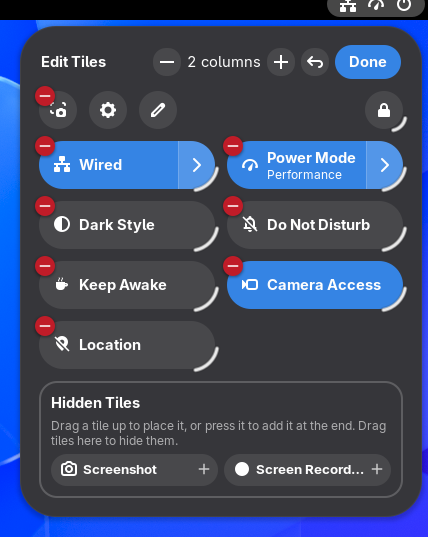
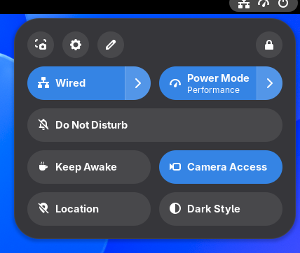
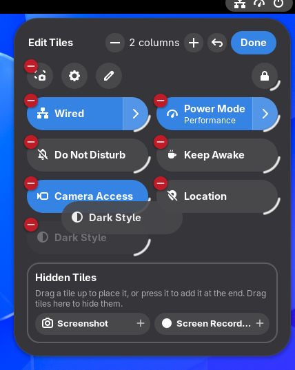
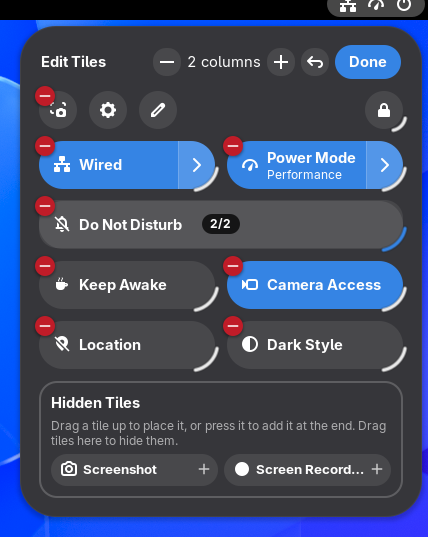
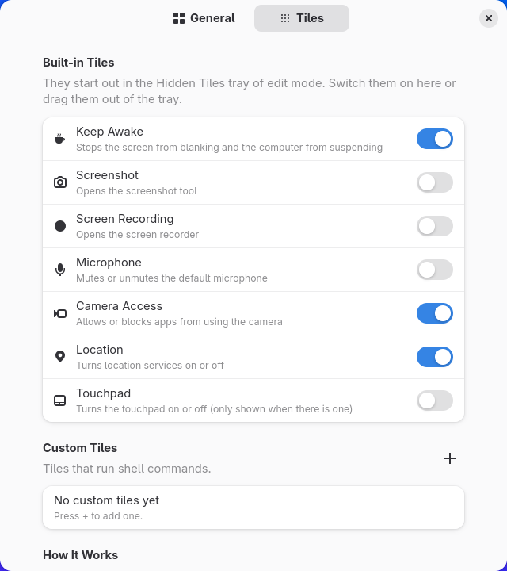

<p align="center">
  
</p>

<h1 align="center">Quick Tiles</h1>

A GNOME Shell 51 extension that lets you customize the Quick Settings menu the way you can on Android/iOS. Everything happens inside the menu itself.

<p align="center">
  
  
</p>

Press the pencil button in the Quick Settings system row to enter edit mode:

- Drag tiles to reorder them; the other tiles move out of the way as you drag
- Drag the arc on a tile's bottom-right corner to make it wider or narrower
- Press **−** on a tile, or drag it onto the **Hidden Tiles** tray, to hide it
- Drag a tile from the tray to where you want it, or press it to add it at the end
- Change the column count with **−**/**+** in the header, undo everything with the reset button, and press **Done** when finished

This works for tiles added by other extensions too.

<p align="center">
  
  
</p>

The extension also comes with a few built-in tiles: **Keep Awake**, **Screenshot**, **Screen Recording**, **Microphone**, **Camera Access**, **Location** and **Touchpad** (only shown when there is one). They start out in the **Hidden Tiles** tray, so the menu stays as it was until you drag the ones you want into it.

The extension's preferences (Extensions app → Quick Tiles) hold the rest:

<p align="center">
  
</p>


- **General:** edit button on/off, reset layout, columns, menu width
- **Tiles:** switch built-in tiles on or off, and create custom tiles that run shell commands (a button, or a toggle with a status command)

## Files

| File | Role |
|---|---|
| `extension.js` | Entry point; wires the parts together and adds the edit button |
| `layout.js` | Applies order, hidden tiles, widths and columns to the Quick Settings grid, and restores Shell's layout on disable |
| `editMode.js` | In-menu edit mode: dragging, the corner resize grip, tray, header |
| `builtinTiles.js`, `builtinCatalog.js` | Built-in tiles (the catalog is shared with the preferences) |
| `commandTiles.js` | Custom command tiles |
| `gtype.js` | Registers classes under free type names so the extension can be reloaded in a running Shell |
| `prefs.js` | Preferences window |

## Installation

```sh
git clone https://github.com/tunjayoff/gnome-quick-tiles.git
cd gnome-quick-tiles
./install.sh
```

The extension is installed to `~/.local/share/gnome-shell/extensions/quicktiles@tunjayoff`. On Wayland, Shell only picks up a newly installed extension at the next login. To skip the login, `install.sh` prints a line to paste into Looking Glass (Alt+F2 → `lg`). The same line also reloads the extension after you change the code.

It loads from a fresh copy in `$XDG_RUNTIME_DIR/quicktiles-dev`, because Shell caches extension modules by path. These copies are removed when you log out. After the next login, Shell uses the normal install location again.

To build the zip for extensions.gnome.org:

```sh
./pack.sh
```

## Custom tiles

Custom tiles are stored as JSON in the `custom-tiles` setting. Create and edit them on the preferences page.

- **Button:** runs its command when clicked.
- **Toggle:** runs the on command when off and the off command when on. If a status command is set, the tile shows as on when it exits with 0, and the first line of its output becomes the subtitle. If a refresh interval is set, the status is checked every that many seconds.

Commands run with `sh -c`.

## How it works

- Each tile is identified by its GType name (e.g. `status_network_NMWirelessToggle`); custom tiles use `custom:<id>`.
- A hidden tile is taken out of the grid without touching its visibility, so the tile's own show/hide logic keeps working.
- The extension tracks the order Shell itself would use. Disabling it restores order, widths and column count exactly.
- Edit mode puts a layer over the grid inside the menu's own actor, so it stays within the menu's input grab. While a tile is dragged, the layer holds its own grab.
- It relies on Shell internals that are not public API, so test it after every GNOME release.

## Tests

```sh
./tests/headless/run.sh
```

This starts a headless GNOME Shell in a temporary folder. It never touches your real session:

- settings go to a temporary keyfile instead of dconf
- the test Shell gets its own runtime directory

The test drives the extension with a virtual pointer and checks:

- ordering, widths and columns
- command tiles
- restoring everything on disable
- built-in tiles
- every edit mode action: dragging, resizing with the grip, hiding into the tray and dragging back out, the − badge, columns, Done
- reloading from a new folder
- that the preferences window opens

Screenshots are saved next to the log.

To regenerate the screenshots in `docs/screenshots`:

```sh
./tests/headless/screenshots.sh
```

## License

GPL-2.0-or-later, the same as GNOME Shell. See [LICENSE](LICENSE).
